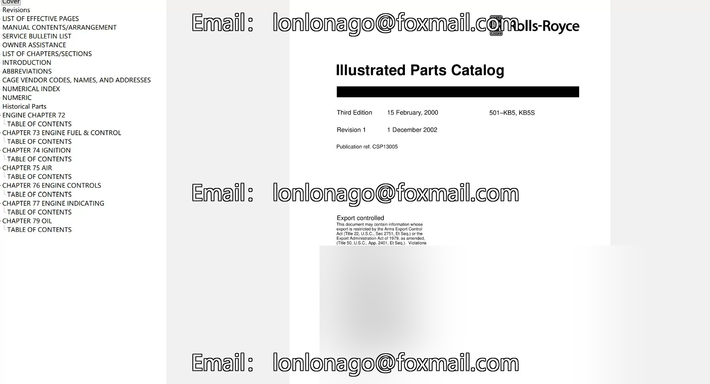
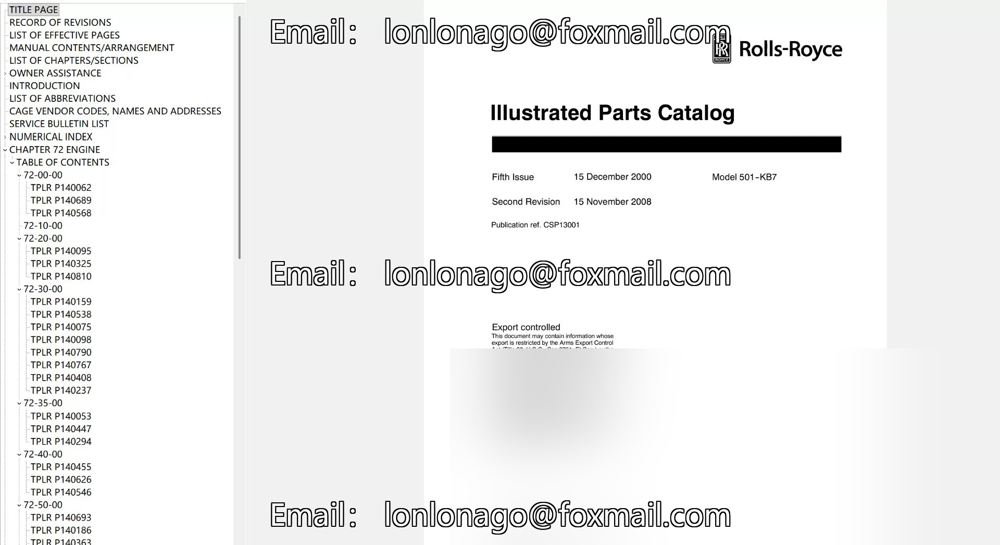
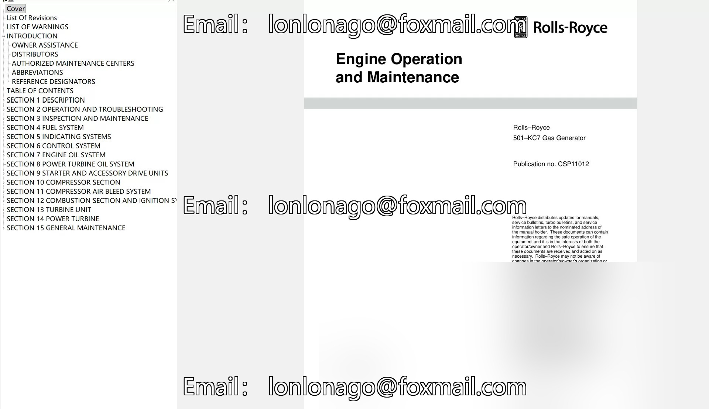
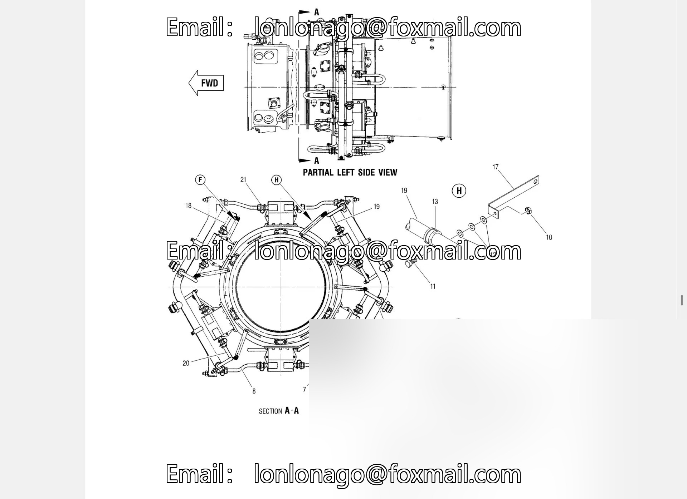
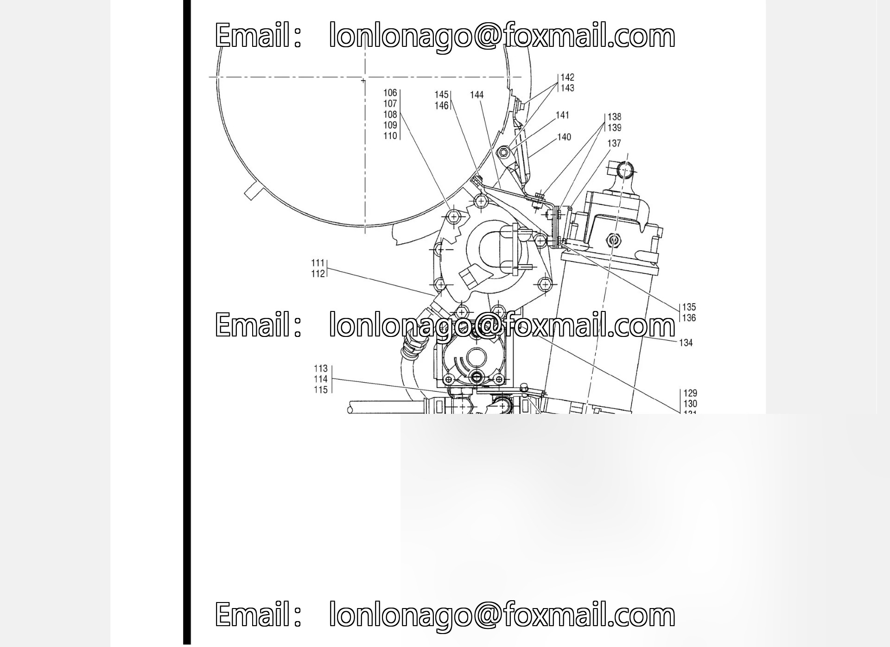
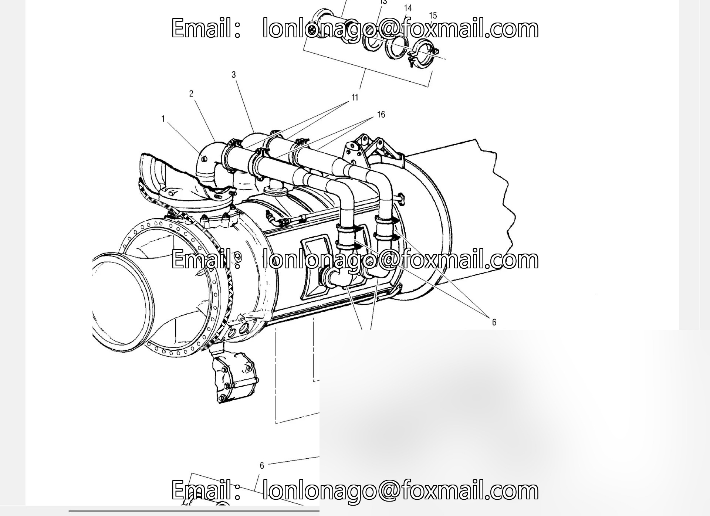

# Rolanda Rovis 501-K series gas turbine

## Body

Rolls-Royce 501-K series gas turbine

501-KB5/KB5S Engine Diagram Part Catalog
501-KB7 Engine Diagram Part Catalog
501-KC7 Gas Generator Operation and Maintenance Manual

complete in content, suitable for reference on engine maintenance and technical research.

Sales do not accept returns or exchanges.

This material covers Rolls-Royce 501-K series gas turbine documents, including cover pages, revision records, part catalogs, manual contents and other relevant sections.

<!-- AI_ENRICHED -->

## Images

## Payment

Here is a pay link on Stripe ( https://buy.stripe.com/3cs8yP7sY87d0vu9AB ). Please contact me lonlonago@foxmail.com after funding $89, and I will send you a complete data files , thank you!

